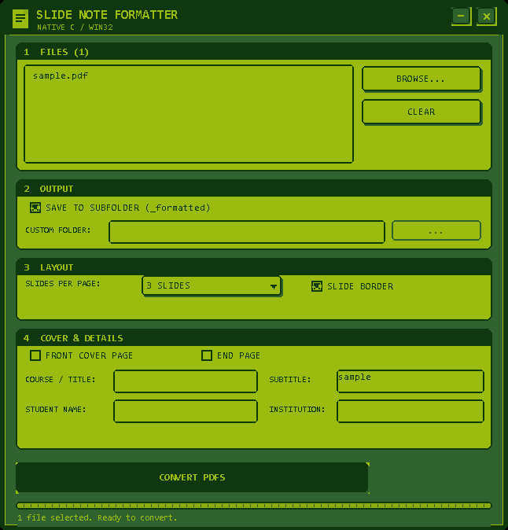

# Retro GB Design Specification

**Slide Note Formatter v2.1** · Windows 10/11

This document defines the Game Boy-inspired design language used by the native
C11/Win32 UI. The goal is a calm, readable, pixel-accurate interface that still
fits a practical batch PDF workflow.

## 1. Palette

Only four colors are used. Intermediate tones are produced with a 1 px dither
pattern, never with gradients or opacity.

| Token | Hex | Usage |
|---|---|---|
| `GB_DARKEST` | `#0F380F` | Outer frame, title bar, selected rows, primary button face, text on light surfaces |
| `GB_DARK` | `#306230` | Page backdrop, shadows, disabled lines, secondary text on dark |
| `GB_LIGHT` | `#8BAC0F` | Dither tone, progress channel, divider lines |
| `GB_LIGHTEST` | `#9BBC0F` | Panels, input surfaces, text on dark surfaces |

Contrast: `GB_DARKEST` / `GB_LIGHTEST` is about 6:1 and is used for body text.
Small text is never `GB_LIGHTEST` on `GB_DARK` unless it is bold and large.

## 2. Typography

- System font: **Consolas**
- Anti-aliasing: **off** (`NONANTIALIASED_QUALITY`)
- Weights: bold for titles, panel headers and primary buttons; normal for labels,
  edits, list rows and status text.
- Sizes at 96 DPI: title 17 px, bold 13 px, normal 12 px, small 11 px.
- All text is upper-case only where it acts as a label or section header.

## 3. Geometry

Base design canvas: **646 × 674** design units at 96 DPI.

- Outer frame: 6 px `GB_DARKEST`, then a 1 px `GB_LIGHTEST` inner line.
- Page margin: 20 px.
- Panel header strip: 20 px.
- Panel frame: 2 px `GB_DARKEST`, 5 px stepped corner cut.
- Buttons and inputs: 2 px frame, 2 px hard shadow on enabled buttons.
- Corner style: pixel-stepped 45° cut. No anti-aliased or blurred corners.
- DPI: Per-Monitor V2; every coordinate goes through `S(value)` / `gb_scale()`.

Layout:

1. Title bar: 44 px.
2. `1 FILES`: file list + Browse / Clear.
3. `2 OUTPUT`: subfolder checkbox, custom folder edit and browse button.
4. `3 LAYOUT`: slides-per-page dropdown and slide-border checkbox.
5. `4 COVER & DETAILS`: cover/end checkboxes and four metadata fields.
6. Bottom action row: Convert PDFs, Open Folder, progress bar and status line.

## 4. Components

### Title bar

Dark `GB_DARKEST` strip with a pixel page icon, `SLIDE NOTE FORMATTER` title and
`NATIVE C / WIN32` subtitle. Custom minimize and close buttons are owner-drawn
with `GB_ROLE_TITLE`; dragging the strip moves the window.

### Panels

Panels are painted in the parent window, not native group boxes. Each has a dark
header strip with a light label and a light `GB_LIGHTEST` body.

### Buttons

Owner-draw buttons with three roles:

- **Primary**: dark face, light text (Convert PDFs).
- **Push**: light face, dark text (Browse, Clear, Open Folder, `...`).
- **Title**: dark square buttons with a pixel X or minus glyph.

Hover uses a darker face. Disabled buttons use a light dithered face with dark
text, so the label stays readable.

### Checkboxes

Square 14 px boxes with a 2 px dark frame. Checked state fills the inside dark
and draws a 2 px pixel check mark. Labels are part of the owner-draw button.

### Dropdown

The slides-per-page control is a custom popup (`GbDropPopupWnd`), not a native
combobox. Rows are copied into the popup's own storage, so stack reuse in the
caller can never leave dangling pointers. Selected row is dark, hover is mid
green, and a 2 × 4 px mark sits left of the selected text.

### File list

Owner-draw listbox: light background, dark text; selected rows use a dark
background, light text and a small pixel marker. Native scrolling remains for
reliability with long batch queues.

### Text inputs

Native `EDIT` controls are kept for IME, clipboard and selection reliability.
They are borderless and framed by the parent with a 2 px `GB_DARKEST` frame;
background and text colors come from `WM_CTLCOLOREDIT`.

### Progress and messages

A segmented GB progress bar sits above the status line. Errors, warnings and the
conversion summary use the custom Game Boy message box, not the Windows dialog.

## 5. Anti-patterns

Never use:

- gradients, glows, blur or translucent layers
- anti-aliased corners or rounded rectangles
- native comboboxes, radio buttons, checkboxes or group boxes in the main UI
- emoji icons in the interface
- generic “AI dashboard” cards, badges or decorative charts

## 6. Icon

The application icon is a 16×16 pixel map rendered into a multi-size `.ico`
(16, 32, 48, 64, 128, 256). It uses the same four colors: a light page, a dark
slide block and three note lines. No anti-aliasing or extra colors.

## 7. Reference

