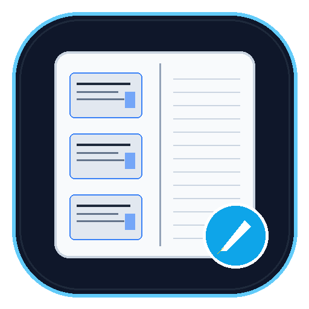

# 🎓 Slide Note Formatter (Slayt Not Formatlayıcı)

<p align="center">
  
</p>

<p align="center">
  <strong>Ders slaytlarını sağ tarafı geniş not alma alanlı, kurum armalı A4 fotokopi ve çalışma dokümanlarına dönüştürün.</strong>
</p>

<p align="center">
  
  
  
  
  
  
</p>

> ⚡ **Ultra-Lightweight Rewrite**: Uygulama, eski 55 MB PyInstaller paketinden tamamen bağımsız, **~210 KB** boyutunda saf C / Win32 ikili dosyası olarak yeniden yazılmıştır. Herhangi bir "tost makinesi" seviyesindeki eski bilgisayarda dahi < 10 ms içinde açılır ve anında çalışır.

---

## 💡 Neden Slide Note Formatter?

Üniversite ve okul derslerinde slaytları fotokopi veya tablet çıktısı alırken standart PDF okuyucular (PDF24 vb.) sayfayı ortalar veya kenarlardan eşit daraltarak sağ tarafta not alma alanı bırakmaz. 

**Slide Note Formatter**, öğrencilerin ve eğitimcilerin ders sunumlarını doğrudan çalışma dokümanına dönüştürmek için özel olarak tasarlandı:
* **Sola Hizalı Slaytlar:** Standart A4 dikey kağıtta slaytları sol tarafa yerleştirir; zımba veya delgeç payı bırakır.
* **Geniş Not Alma Alanı:** Sayfanın sağ tarafında boydan boya **~10.4 cm genişliğinde** temiz not alanı sağlar.
* **Resmi Ön Kapak & Bitiş:** Dilediğiniz üniversite veya kurum armasıyla, ders adı, konu ve öğrenci bilgisi içeren zarif bir ön kapak ve modül kapanış sayfası ekler.
* **100% Çevrimdışı ve Güvenli:** Belgeleriniz hiçbir sunucuya yüklenmez; her şey cihazınızda yerel olarak işlenir.

---

## ✨ Özellikler

| Özellik | Açıklama |
|---|---|
| **Toplu İşlem (Batch)** | Tek bir PDF dosyasını veya klasördeki onlarca sunumu tek tıkla dönüştürün. |
| **Kalıcı Profil Hatırlama** | Adınızı, üniversite/okul adınızı ve alt başlığınızı kaydeder; her açılışta otomatik hatırlar. |
| **Özel Logo Desteği** | Dahili üniversite armasını kullanabilir veya istediğiniz herhangi bir okul/kurum logosunu (`PNG`/`JPG`) seçebilirsiniz. |
| **Esnek Şablonlar (Presets)** | • 3 Slayt + Kapak (Önerilen)<br>• 2 Slayt + Kapak (Geniş aralıklar)<br>• 3 Slayt (Kapaksız)<br>• 2 Slayt (Kapaksız)<br>• 4 Slayt (Kompakt) |
| **Baskı & Kalite Optimizasyonu** | • 144 DPI baskı netliği<br>• Grayscale (Siyah-Beyaz fotokopi için toner tasarrufu)<br>• Slayt kenarlarından 1 mm temizleme kırpması |
| **Sayfa Filigranı** | Her sayfanın sağ üst köşesine öğrenci adını hafif opaklıkla (7 pt) yerleştirerek çıktının karışmasını önler. |
| **Modern Karanlık/Aydınlık Arayüz** | Windows 11 tasarım diliyle uyumlu CustomTkinter arayüzü. |

---

## 🚀 Başlangıç

### Seçenek 1: Hazır `.exe` İle Çalıştırma (Kurulumsuz)
Python veya kütüphane kurulumu yapmadan doğrudan çift tıklamayla kullanmak için `dist/SlideNoteFormatter.exe` dosyasını çalıştırın.

### Seçenek 2: Kaynak Koddan Çalıştırma

1. **Depoyu klonlayın:**
   ```bash
   git clone https://github.com/haluked/slide-note-formatter.git
   cd slide-note-formatter
   ```

2. **Gereksinimleri yükleyin:**
   ```bash
   pip install -r requirements.txt
   ```

3. **Uygulamayı başlatın:**
   ```bash
   python src/app.py
   ```

---

## 🛠️ Kendi `.exe` Dosyanızı Derleme

Proje kök dizinindeki `build.bat` dosyasını çift tıklayarak çalıştırabilir veya aşağıdaki komutla derleyebilirsiniz:

```bash
python -m PyInstaller ^
    --noconsole ^
    --onefile ^
    --collect-all customtkinter ^
    --add-data "assets\icon.ico;assets" ^
    --add-data "assets\polito_logo.png;assets" ^
    --icon "assets\icon.ico" ^
    --name "SlideNoteFormatter" ^
    --distpath "dist" ^
    "src\app.py"
```

Derleme tamamlandığında bağımsız çalıştırılabilir dosya `dist/SlideNoteFormatter.exe` altında oluşturulur.

---

## 📂 Proje Yapısı

```
slide-note-formatter/
├── assets/
│   ├── icon.ico                # Çoklu çözünürlüklü uygulama ikonu
│   ├── icon.png                # 512x512 yüksek çözünürlüklü logo
│   └── polito_logo.png         # Politecnico di Torino siyah-beyaz vektörel arması
├── src/
│   ├── app.py                  # CustomTkinter arayüzü ve olay yönetimi
│   ├── config.py               # Kalıcı kullanıcı ayarları (~/.slide_note_formatter)
│   ├── pdf_engine.py           # PyMuPDF (MuPDF) dönüştürme ve sayfa motoru
│   └── assets.py               # Gömülü logo ve ikon yöneticisi
├── .gitignore                  # Git dışlama kuralları
├── build.bat                   # Tek tıkla Windows derleme komutu
├── LICENSE                     # MIT Açık Kaynak Lisansı
├── README.md                   # Dokümantasyon
└── requirements.txt            # Python bağımlılıkları
```

---

## 📜 Lisans

Bu proje [MIT Lisansı](LICENSE) altında lisanslanmıştır. Dilediğiniz gibi kullanabilir, özelleştirebilir ve dağıtabilirsiniz.

Geliştirici: **Haluk Tanrıseven** ([@haluked](https://github.com/haluked))
