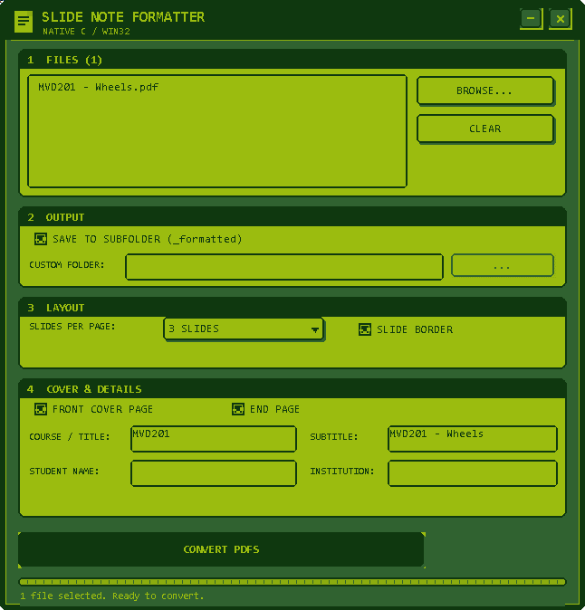
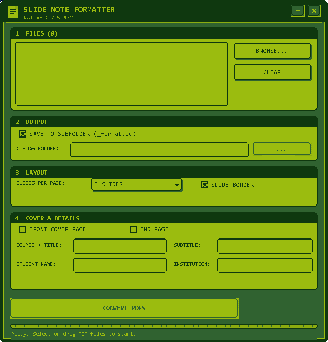
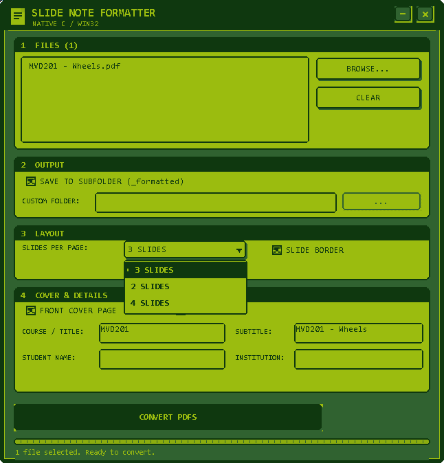
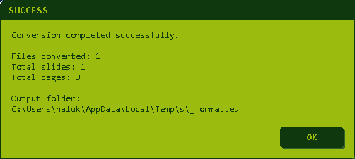

# Slide Note Formatter

**v2.1.2 · Native C11 / Win32 · Windows 10/11 · MIT**

<p align="center">
  
</p>

> Turn lecture slide PDFs into A4 study handouts with a wide note-taking margin and an optional cover page.

Slide Note Formatter is a native C11 / Win32 desktop application. It runs as a single executable, works fully offline, and does not need an installer or an external runtime.



## Features

- **Retro GB interface:** four-shade DMG palette, pixel-stepped corners, custom-drawn buttons, checkboxes, dropdown, file list and message boxes.
- **Batch conversion:** process one PDF or many PDFs in one run.
- **Mixed page sizes:** landscape slides stay in the grid; portrait/A4 pages get their own full A4 page, so annotation and solution scans are never squeezed into a slide slot.
- **Dense mixed-page packing:** landscape/square pages count as 1/3 and portrait pages as 2/3, so one slide plus one tall page can share a single A4 sheet. Two slides plus a tall page stay as two sheets so nothing becomes unreadably small.
- **Page layout:** 2, 3 or 4 slides per A4 page.
- **Slide border:** optional thin frame around each slide.
- **Note column:** optional blank note area on the left or right, with a configurable width in millimetres.
- **Slide spacing:** adjustable vertical gap between slides.
- **Ruled lines:** optional writing lines inside the note column.
- **Annotation flattening:** handwritten notes and annotations stored as PDF annotation appearances are included in the output.
- **Front cover and end page:** course, subtitle, student name and institution.
- **Flexible output:** a `_formatted` subfolder next to each source, or a custom folder.
- **Drag and drop:** drop PDF files directly onto the window.
- **Progress bar:** GB-style conversion progress.
- **Fully offline:** documents are never uploaded anywhere.
- **Small:** about 240 KB single executable.

## Screenshots

| Main window | File ready |
|---|---|
|  |  |
| **Slides per page** | **Conversion complete** |
|  |  |

## Icon

<p align="center">
  
</p>

Selected icon: **06 — Two Slides**. The full set of ten icon studies is on the
[icon contact sheet](assets/icon-alts/contact-sheet.png).

## Download

Latest release: [GitHub Releases](https://github.com/haluked/slide-note-formatter/releases/latest)

Run `SlideNoteFormatter.exe` directly. No installation is required.

## Build

Requirements:

- MinGW-w64 GCC (C11)
- `windres`
- zlib (`-lz`)

One command:

```cmd
build.bat
```

Output: `dist\SlideNoteFormatter.exe`

## Usage

### GUI

1. Choose PDFs with **BROWSE...** or drag them onto the window.
2. Set the page layout, note column, slide gap and optional cover details.
3. Press **CONVERT PDFS**.

### CLI

```cmd
SlideNoteFormatter.exe <input.pdf> [output.pdf] [slides_per_page] [-author "Name"] [-course "Course"] [-module "Subtitle"] [-uni "Institution"]
```

Example:

```cmd
SlideNoteFormatter.exe lecture.pdf output.pdf 3 -author "Haluk Tanriseven"
```

## Design

The palette, typography, measurements and component rules are documented in
[DESIGN.md](DESIGN.md).

## Project structure

```
slide-note-formatter/
├── src_c/
│   ├── main.c          # Win32 interface and CLI
│   ├── gb_ui.c         # GB palette, drawing and custom controls
│   ├── gb_ui.h
│   ├── pdf_engine.c    # PDF conversion engine
│   ├── pdf_engine.h
│   ├── res.rc          # icon and version information
│   └── res.manifest    # Per-Monitor V2 DPI
├── assets/             # icon, institution logo, screenshots and icon studies
├── build.bat
├── DESIGN.md
├── LICENSE
└── README.md
```

## License

MIT. See [LICENSE](LICENSE).
